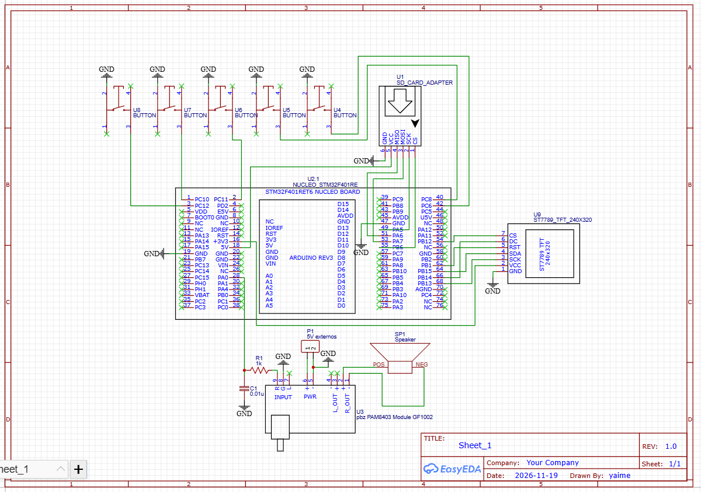

# Reproductor de música WAV con pantalla TFT — STM32F401RE (bare-metal)

Proyecto 4 de **Microprocesadores e Interfaces (MPEI) 2026** — Escuela Colombiana de Ingeniería Julio Garavito.

**Autores:** Jaime Galvis y Maira Prieto\
**Profesor:** Juan David Guerrero Balaguera

Reproductor de archivos WAV que lee 40 canciones de una microSD (FAT32), las reproduce
con un DAC por PWM y muestra el nombre de la canción, el estado y un menú en una pantalla
TFT ST7789 de 240×320. Se controla con cinco botones: Pause, Stop, Next, Prev y Menu.

Todo el firmware está escrito **sin HAL, LL ni CubeMX**: los drivers de los periféricos
son propios y trabajan directamente con los registros, y el arranque (`crt0.S`), el linker
script y el Makefile también son propios. Se compila con la cadena GNU
(`arm-none-eabi-gcc` y `make`) y se graba con OpenOCD.

---

## Contenido

1. [Estructura del repositorio](#1-estructura-del-repositorio)
2. [Materiales](#2-materiales)
3. [Conexiones](#3-conexiones)
4. [Instalar las herramientas](#4-instalar-las-herramientas)
5. [Compilar y grabar](#5-compilar-y-grabar)
6. [Preparar la microSD](#6-preparar-la-microsd)
7. [Uso](#7-uso)
8. [Pruebas por componente](#8-pruebas-por-componente)
9. [Problemas comunes](#9-problemas-comunes)
10. [Librerías externas y créditos](#10-librerías-externas-y-créditos)
11. [Uso de inteligencia artificial](#11-uso-de-inteligencia-artificial)

---

## 1. Estructura del repositorio

```
.
├── main.c               Lógica del reproductor: estados, botones, doble buffer, menú
├── crt0.S               Arranque: tabla de vectores, copia .data, limpia .bss, llama a main
├── linker_script.ld     Mapa de memoria: Flash 512 KB en 0x08000000, RAM 96 KB en 0x20000000
├── Makefile             Compilación con arm-none-eabi-gcc y grabación con OpenOCD
├── inc/                 Encabezados propios (gpio.h, spi.h, sd.h, tft.h, audio.h, ...)
│   └── cmsis/           Encabezados CMSIS (nombres de los registros del STM32F401)
├── src/                 Drivers propios
│   ├── system.c         Reloj a 84 MHz y delay_ms
│   ├── gpio.c           Configuración, lectura y escritura de pines
│   ├── uart.c           USART2 para depuración (115200 baudios)
│   ├── spi.c            SPI1 (microSD) y SPI2 (pantalla)
│   ├── sd.c             Protocolo de la microSD por SPI (CMD0, CMD8, ACMD41, CMD58, CMD17)
│   ├── audio.c          TIM2 = PWM en PA0 (~328 kHz); TIM3 = interrupción a 22 050 Hz
│   ├── tft.c            Driver de la ST7789: inicio, ventana, píxel, rectángulo
│   └── pantalla.c       Interfaz: pantalla de reproducción y menú
├── source/              FatFs (elm-chan) — sistema de archivos FAT32
│   └── diskio.c         Puente entre FatFs y sd.c (escrito por nosotros)
├── tft_fuentes/         Dibujo de texto
│   ├── tft_text.c/.h    Dibuja letras con fuentes en formato GFXfont (propio)
│   ├── gfxfont.h        Estructuras de las fuentes
│   ├── Adafruit_GFX.h   Archivo puente para usar las fuentes sin Arduino
│   └── Fonts/           Fuentes de Adafruit GFX (FreeSansBold 9/12/18 pt)
├── sd/                  NOMBRES.TXT de ejemplo para copiar a la microSD
├── docs/                Informe en PDF, esquemático, diagramas y fotos
└── USO_DE_IA.md         Declaración detallada del uso de IA
```

## 2. Materiales

| Cantidad | Componente            | Notas                                                         |
| -------- | --------------------- | ------------------------------------------------------------- |
| 1        | Nucleo-F401RE         | STM32F401RE (Cortex-M4) con ST-Link integrado                 |
| 1        | Módulo lector microSD | SIG0104 (SPI), alimentado a 5 V                               |
| 1        | microSD               | 32 GB, formateada en FAT32                                    |
| 1        | Pantalla              | TFT ST7789 240×320 (SPI), alimentada a 3,3 V                  |
| 1        | Amplificador          | Módulo GF1002 (PAM8403) con potenciómetro, fuente externa 5 V |
| 1        | Parlante              | 8 Ω, 10 W                                                     |
| 1        | Filtro RC pasa-bajos  | R = 1 kΩ, C = 10 nF (código 103) → f<sub>c</sub> ≈ 15,9 kHz   |
| 5        | Pulsadores            | Pause, Stop, Next, Prev, Menu                                 |
| —        | Cables y protoboard   |                                                               |

## 3. Conexiones

### Esquemático



Archivo editable (EasyEDA): [`docs/esquematico.json`](docs/esquematico.json)

### Pines

| Periférico                       | Señal             | Pin del micro     |
| -------------------------------- | ----------------- | ----------------- |
| microSD (SPI1)                   | SCK / MISO / MOSI | PA5 / PA6 / PA7   |
|                                  | CS                | PB6               |
| Pantalla ST7789 (SPI2)           | SCK / SDA         | PB13 / PB15       |
|                                  | CS / DC / RST     | PB12 / PB14 / PB1 |
| Audio (TIM2 CH1)                 | PWM               | PA0               |
| Botones (a GND, pull-up interno) | Pause / Stop      | PC10 / PC11       |
|                                  | Next / Prev       | PC12 / PC8        |
|                                  | Menu              | PC6               |
| Encender / apagar                | Botón azul        | PC13              |
| Depuración (USART2)              | TX / RX           | PA2 / PA3         |

### Audio

PA0 → filtro RC pasa-bajos (R1 = 1 kΩ, C1 = 10 nF, código 103) → entrada R del módulo GF1002
(amplificador PAM8403) → parlante.

- **Filtro RC:** frecuencia de corte f<sub>c</sub> = 1 / (2π·R·C) ≈ 15,9 kHz. Deja pasar
  el audio (hasta ~11 kHz) y atenúa la portadora del PWM (~328 kHz).
- **Salida en puente:** el parlante va entre `R_OUT+` y `R_OUT−`. Ninguna de las dos
  salidas se conecta a GND: el PAM8403 maneja cada terminal con una señal opuesta.
- **Volumen:** se ajusta en dos puntos. En el firmware, cada muestra se desplaza
  `VOLUMEN_SHIFT` bits a la derecha antes de enviarla al PWM (con 1 bit la amplitud
  queda a la mitad, unos −6 dB), para no saturar el amplificador. En el hardware, el
  potenciómetro del módulo GF1002 ajusta la ganancia final.

### Alimentación

- **Nucleo-F401RE:** por el USB del ST-Link, desde el computador.
- **microSD:** desde el pin de 5 V de la Nucleo.
- **Pantalla:** desde el pin de 3,3 V de la Nucleo.
- **Amplificador GF1002:** desde una **fuente externa de 5 V**. No se alimenta desde
  la Nucleo porque esta recibe su energía del USB del computador y la corriente no
  alcanza para el parlante (se producían reinicios).
- **Tierra común:** el GND de la fuente externa está unido al GND de la Nucleo; sin
  eso la señal de audio no tiene una referencia común.

## 4. Instalar las herramientas

El proyecto se compila con la **cadena GNU para ARM**, sin IDE. Se probó en
**Windows 11 + WSL (Ubuntu)**; en Linux nativo es igual, sin el paso de `usbipd`.

### En WSL / Ubuntu

```bash
sudo apt update
sudo apt install gcc-arm-none-eabi make openocd git
```

Comprobar:

```bash
arm-none-eabi-gcc --version
openocd --version
```

### En Windows (solo si usan WSL): pasar el ST-Link a WSL

1. Instalar usbipd-win (en PowerShell): `winget install usbipd`
2. Conectar la Nucleo por USB y buscar su número de bus:
   ```powershell
   usbipd list
   ```
   Buscar la fila *ST-Link Debug, USB Mass Storage, USB Serial Device* (por ejemplo `1-2`).
3. **Solo la primera vez**, en PowerShell **como administrador**:
   ```powershell
   usbipd bind --busid 1-2
   ```
4. **Cada vez que conecten la placa** (sin administrador):
   ```powershell
   usbipd attach --wsl --busid 1-2
   ```
5. En WSL, comprobar que aparece: `lsusb` → `STMicroelectronics ST-LINK/V2.1`.

## 5. Compilar y grabar

```bash
git clone [enlace del repositorio]
cd [nombre de la carpeta]
make            # compila y muestra el uso de memoria
make flash      # graba main.elf en la placa con OpenOCD
make clean      # borra los archivos compilados
```

Al terminar, `make` muestra el tamaño de cada sección (`arm-none-eabi-size`).
Valores de referencia: [.text = ... bytes, .rodata = ... bytes, .bss = ... bytes].

### Qué hace el Makefile

- Compila todos los `.c` de la carpeta principal, `src/`, `source/` y `tft_fuentes/`,
  y el `crt0.S`, con `-mcpu=cortex-m4 -std=c11 -ffreestanding -Og -g`.
- Busca encabezados en `inc/`, `inc/cmsis/`, `source/` y `tft_fuentes/`.
- Enlaza con `linker_script.ld` y `-nostdlib`, agregando solo `libc` y `libgcc`.
- `make flash` usa OpenOCD con `interface/stlink.cfg` y `target/stm32f4x.cfg`.

### Qué hace el linker script

[Explicar: regiones FLASH y RAM, dónde quedan .text, .rodata, .data (en RAM, con su
copia inicial en Flash), .bss y la pila, y los símbolos que usa crt0.S.]

## 6. Preparar la microSD

1. Formatear la microSD en **FAT32**.
2. Crear la carpeta `MUSIC/EPIC/` en la raíz.
3. Convertir cada canción a **WAV mono, 22 050 Hz, 16 bits** y nombrarlas
   `CANC01.WAV` … `CANC40.WAV`. Con [FFmpeg](https://ffmpeg.org/):
   ```bash
   ffmpeg -i "cancion original.mp3" -ac 1 -ar 22050 -c:a pcm_s16le CANC01.WAV
   ```
   (`-ac 1` = mono, `-ar 22050` = frecuencia de muestreo, `pcm_s16le` = 16 bits con signo).
4. Copiar `NOMBRES.TXT` a la misma carpeta: **una línea por canción, en el mismo orden**
   que los archivos (línea 1 = CANC01). Solo caracteres ASCII, sin tildes ni ñ (la fuente
   no las tiene). Si el archivo no está, la pantalla muestra `CANC01`, `CANC02`...

Estructura final de la SD:

```
MUSIC/
└── EPIC/
    ├── CANC01.WAV
    ├── ...
    ├── CANC40.WAV
    └── NOMBRES.TXT
```

## 7. Uso

| Botón         | Pantalla de reproducción                               | Menú abierto                            |
| ------------- | ------------------------------------------------------ | --------------------------------------- |
| **Azul**      | Enciende / apaga                                       | Apaga                                   |
| **Menu**      | Abre el menú (pausa la música)                         | Sale sin cambiar de canción             |
| **Next**      | Siguiente canción (40 → 1)                             | Baja la selección                       |
| **Prev**      | Canción anterior (1 → 40)                              | Sube la selección                       |
| **Pause**     | Pausa / continúa (si está en Stop, empieza la canción) | Elige la canción marcada y la reproduce |
| **Stop**      | Detiene la canción                                     | Sale sin cambiar de canción             |

- Al encender se abre el menú para elegir la canción.
- Al terminar una canción pasa sola a la siguiente.
- Por el puerto serie (115200 baudios, 8N1) se ven mensajes de depuración: montaje de la
  SD, canción que se abre, botones presionados.

## 8. Pruebas por componente

[Pendiente: programas de prueba de cada driver y módulo.]

## 9. Problemas comunes

| Síntoma                        | Causa                          | Solución                                       |
| ------------------------------ | ------------------------------ | ---------------------------------------------- |
| `make flash` → `open failed`   | ST-Link no conectado a WSL     | `usbipd attach --wsl --busid 1-2`              |
| `Device is not shared`         | Falta el `bind`                | `usbipd bind --busid 1-2` (administrador)      |
| CMD0 no responde `01` (UART)   | Cableado de la SD o PB3 usado  | Revisar PA5–PA7 y PB6; no usar PB3 (SWO)       |
| Colores invertidos en pantalla | Inversión activa en la ST7789  | `tft_init` envía INVOFF (0x20)                 |
| Sale `CANCxx` y no el nombre   | No encontró `NOMBRES.TXT`      | Debe estar en `MUSIC/EPIC/`                    |
| Audio saturado                 | Ganancia alta del amplificador | Bajar el potenciómetro o subir `VOLUMEN_SHIFT` |

## 10. Librerías externas y créditos

Todos los drivers de periféricos del microcontrolador son propios. Las únicas partes
externas son:

- **FatFs** de ChaN (elm-chan) — `source/` (excepto `diskio.c`). Licencia propia tipo BSD.
  <http://elm-chan.org/fsw/ff/>
- **Fuentes de Adafruit GFX** (derivadas de GNU FreeFont) — `tft_fuentes/Fonts/`. Solo los
  datos de las fuentes; el dibujo (`tft_text.c`) es propio. Licencia BSD (Adafruit) y GPL
  con excepción de fuentes (FreeFont).
  <https://github.com/adafruit/Adafruit-GFX-Library>
- **CMSIS** (ARM / STMicroelectronics) — `inc/cmsis/`, solo encabezados de registros.

## 11. Uso de inteligencia artificial

Se usaron herramientas de IA durante el desarrollo. El detalle (qué herramienta, para qué,
qué código se generó y cómo se revisó y modificó) está en [USO_DE_IA.md](USO_DE_IA.md).